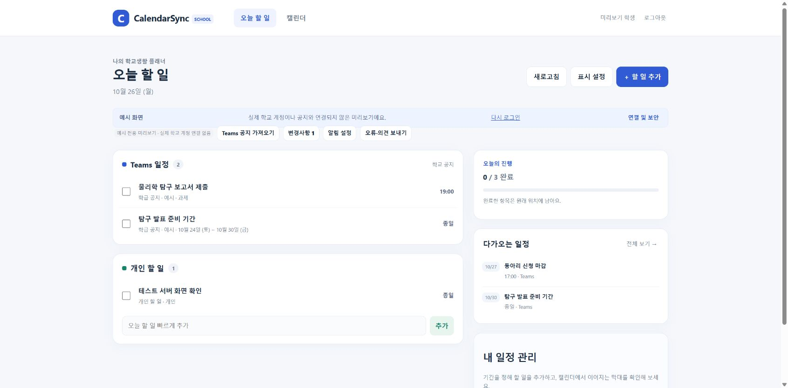
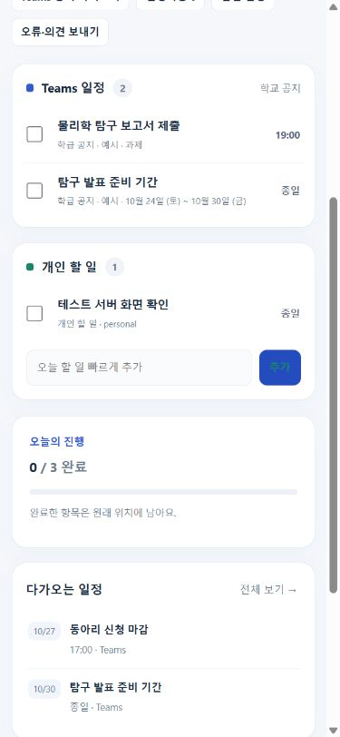

# CalendarSync 테스트 서버

학교 계정으로 로그인하고, 학생에게 허용된 Teams 공지를 수집·분석해서 웹에 표시하는 소규모 테스트 버전이다. 기존 Teams 봇의 app/ 코드와 Oracle 운영 테이블을 수정하지 않는다. 기본 수집 방식은 **학생별 delegated Graph 권한을 쓰는 direct 모드**이며 Oracle 읽기 전용 재사용도 선택할 수 있다.

## 1. 지금 화면부터 확인하기

저장소 루트에서 Python 3.12 이상으로 실행한다.

```
python -m pip install -r requirements-web.txt
python -m web_service --demo
```

Windows에서는 의존성을 설치한 뒤 start_web_preview.cmd를 실행할 수도 있다. 기본 주소는 **http://127.0.0.1:8093**이다. 예시 데이터로 시작하기를 누르면 대시보드가 열린다. Microsoft 계정·OpenAI·학교 DB·푸시 발송과 연결하지 않는 별도 예시 모드다. 예시 기기·사용자는 격리된 preview DB에만 저장하며, 실제 학교 계정 데이터가 들어 있는 DB는 열지 않는다. 이 모드는 localhost에서만 실행하고 공용 프록시에 게시하지 않는다.

확인할 수 있는 화면: 오늘 할 일, 개인 할 일 편집과 완료, 기간 막대 캘린더, 채널·종류 필터, 숨김·복원, 나만 일정 수정, 예약 알림 설정, 변경사항 검토, 알림 설정, 오류·의견 보내기. 예시 모드의 알림 설정 화면은 실제 푸시 키가 없으므로 발송을 활성화하지 않는다. Teams 공지 가져오기를 누르면 예시 마감 시각의 변경 후보를 만들 수 있다.

## 2. 실제 학교 계정 테스트 서버 준비

기존 봇과 별도 가상환경에 설치한다.

```
python -m venv .venv-web
# Windows: .venv-web\Scripts\activate
# Linux: source .venv-web/bin/activate
python -m pip install -r requirements-school.txt
```

`deploy/school.test.env.example`을 `deploy/school.test.env`로 복사해서 실제 값을 설정한다. 실제 파일은 Git에서 제외된다. `python -m web_service --generate-keys /안전한/새파일.private.env`로 웹 암호화 키와 VAPID 키를 최초 한 번 만들 수 있다. 파일은 덮어쓰지 않고 비밀값도 콘솔에 출력하지 않는다. 생성한 두 값을 테스트 서버 설정에 옮기고, DB를 유지하는 동안 같은 키를 보관한다. 브라우저 알림을 등록한 뒤 VAPID 키를 임의로 바꾸면 재등록이 필요하다.

학교 Entra 앱 설정:

- 학교 단일 tenant의 Web 앱. Redirect URI: `${WEB_ORIGIN}/auth/callback`.
- Graph delegated 권한: User.Read, Team.ReadBasic.All, Channel.ReadBasic.All, ChannelMessage.Read.All. 기존 앱의 application 권한과 구분해서 현재 동의 상태를 확인한다.
- 이 기기 연동 유지를 선택하면 MSAL이 offline_access와 갱신 토큰을 관리하는 캐시를 서버에 암호화해 보관한다. 웹이 refresh token을 직접 브라우저에 전달하지 않는다.
- 테스트 대상 학교 계정만 Enterprise application에 할당한다. 게스트·다른 tenant는 현재 차단한다. 외부 테스트 계정은 이번 범위에서 제외한다.
- MFA·기기 조건은 학교 Entra 정책에서 적용한다. 코드가 학교 관리자 정책을 변경하지 않는다.

수집 설정:

- WEB_INGESTION_MODE=direct: WEB_OPENAI_API_KEY 필요. 본문과 Graph hosted image, 확장된 답글을 분석한다. WEB_AI_IMAGES_ENABLED=0이면 이미지 분석을 끈다. 지원 모델 기본값은 gpt-4o-mini다.
- WEB_INGESTION_MODE=oracle: 기존 읽기 전용 Oracle 설정을 사용한다. 학생의 현재 채널 권한은 여전히 Graph로 검증한다. 이 경로는 기존 수집기의 수집 범위와 추출 품질에 의존한다.
- 실제 공지와 지원되는 이미지는 일정 추출을 위해 OpenAI에 전송된다. 이 이용 내용을 테스트 참여자에게 알리고 학교의 기존 처리 범위와 맞는지 확인한 뒤 키를 설정한다.

푸시 설정:

- WEB_VAPID_PRIVATE_KEY: 생성한 P-256 PKCS8 DER의 base64url 값.
- WEB_VAPID_SUBJECT: 운영팀의 실제 mailto: 연락처.
- Microsoft 토큰이나 OpenAI 키와 서로 다른 키다. 키가 설정되지 않으면 알림 등록 버튼을 비활성화한다.

실행:

```
python -m web_service --school --env-file deploy/school.test.env --no-browser
```

Windows는 start_school_test.cmd도 사용할 수 있다. 기본 서버는 127.0.0.1:8080에만 바인딩한다. Nginx 등에서 **공용 HTTPS**로 연결한다. `deploy/calendarsync-test.service`와 기존 Nginx 예제를 참고하되 실제 호스트·인증서·환경 파일·DB 경로를 맞추고 nginx -t를 실행한다. 테스트용 DB·키·서비스 프로세스를 운영 봇과 구분한다. 이 개발 작업에서 학교 Entra, 실제 서버 환경 파일, 공용 도메인, 인증서 또는 방화벽을 설정하지는 않았다.

## 3. 로그인과 알림 정책

- 기본 화면 세션 8시간, 무활동 30분. 화면이 자동 만료돼도 기기 연결은 유지한다.
- 로그인 시 이 기기 연동 유지를 선택한 기기만 최대 30일 동안 백그라운드 갱신과 알림을 사용할 수 있다. 학교 정책·토큰 철회·동의 취소로 더 빨리 재로그인이 필요할 수 있다.
- 이번 사용만 로그인은 갱신 캐시를 보관하지 않고 브라우저 알림도 등록할 수 없다.
- 직접 로그아웃하면 이 기기의 세션·저장 자격 증명·푸시 등록을 폐기한다. 모든 기기 로그아웃은 이 계정의 모든 연결을 폐기한다. 다른 계정으로 로그인해도 이전 기기 연결을 먼저 해제한다.
- 서버는 토큰 만료 전 MSAL의 acquire_token_silent_with_error로 갱신한다. 동시 갱신 잠금과 폐기 시점 검사를 통해 로그아웃 뒤 늦은 결과가 자격 증명을 되살리지 못하게 한다.
- 30일 연결 기간이 지난 자격 증명은 유지보수 작업에서 비운다. 자동 세션 만료와 명시적 연결 해제는 서로 다른 동작이다.
- 브라우저 알림은 사용자가 해당 기기에서 직접 켜야 한다. 탭이 닫혀 있을 때 수신하려면 브라우저·OS의 Web Push 지원과 권한이 필요하다. iOS/iPadOS는 홈 화면에 추가한 웹앱에서 시험한다. OS가 브라우저를 중단하거나 네트워크를 끊으면 즉시 수신을 보장할 수 없다.
- 잠금화면에는 일정 제목·본문을 넣지 않고 확인 안내만 보낸다. 알림을 누르면 웹으로 이동하며 화면 세션을 확인한다. Service Worker는 로그인 페이지·API 응답을 캐시하지 않는다.

## 4. 수집·변경·알림 범위

- 기존 봇 설치 없이 웹 계정으로 발견한 채널을 수집한다. 채널 목록의 이름만으로 접근을 인정하지 않고 학생의 messages 읽기 권한을 확인한다.
- 소규모 베타의 과금·처리 시간 제한: 최근 30일 신규 공지, 채널별 최근 50개 목록, 한 작업에서 채널 최대 5개를 순환 처리한다. 기존에 저장된 원문이 목록에서 빠졌다는 이유만으로 삭제하지 않고 제한된 수의 원문을 다시 조회한다. 큰 계정은 첫 수집이 여러 주기에 걸릴 수 있다. 초기 전체 과거 공지 수집을 보장하는 버전은 아니다.
- 일정은 전체 기간을 유지하고 학년으로 자동 제외하지 않는다. 같은 채널·원문의 같은 key는 안정된 일정 ID를 사용한다. 채널 간 의미 기반 중복 통합은 아직 구현하지 않았다.
- 변경된 원문·답글에서 추출한 차이와 확인된 삭제·취소는 사용자별 변경 후보로 저장한다. 기존 유지 또는 변경 반영을 선택한다. 변경 반영은 그 사용자의 현재 수정 내용을 대체한다. 검토 중인 일정의 예약 알림은 중단한다.
- 수집/AI 오류를 일정 없음 또는 삭제로 처리하지 않는다. 권한 확인에 실패하면 Teams 조회와 해당 일정 알림을 차단한다. 개인 할 일은 별도로 저장한다.
- 기기당 Web Push 등록, 테스트 알림, 아침 기본 07:00(변경·끄기), Teams/개인 분리, 하루 전·1시간 전·직접 시각 알림을 제공한다. 완료·취소·숨김·꺼둔 채널/종류는 제외한다.
- 알림은 60초 주기의 단일 프로세스 작업이 처리한다. 수집은 기본 5분 간격으로 시도하며 권한 확인은 알림 전 현재 유효성 기준으로 갱신한다. 제한된 사용자 묶음과 처리 예산 때문에 대규모 학교 배포 전에는 작업 큐와 처리량 검증이 필요하다.
- 알림은 10분 전송 창, 최대 5회 재시도와 기기별 발송 기록을 쓴다. 네트워크 전송 직후 서버가 중단되면 중복 가능성을 완전히 없앨 수 없어서 브라우저 tag로 겹친 알림을 정리한다. 404/410 구독은 해제한다. 이미 푸시 서비스에 전달된 알림은 로그아웃 후에도 도착할 수 있으며 내용은 일반 안내로 제한한다.
- Teams/Outlook 캘린더 자동 등록과 Teams 채팅 발송은 이번 테스트 서버에서 제공하지 않는다. 기존 봇의 캘린더 쓰기를 웹이 중복 실행하지 않는다.

## 5. 테스트 순서

1. 로컬 예시 화면: 오늘·월간·기간 막대·입력·수정·완료·숨김/복원·변경 후보·알림 설정 표시 확인.
2. 실제 계정 두 개로 로그인: 서로 다른 채널과 개인 할 일이 분리되는지, 다른 tenant가 거부되는지 확인.
3. Teams 실제 공지: 텍스트·이미지·답글·기간·수정·취소 테스트. 일부 채널을 꺼서 표시와 알림 제외를 확인.
4. 각 기기에서 알림 허용 → 테스트 알림 → 가까운 직접 지정 알림. 완료·숨김·취소 후 전송 중단 확인.
5. 화면 세션 만료 후 수신, 직접 로그아웃 후 중단, 모든 기기 로그아웃, 계정 전환, Graph 권한 철회와 토큰 갱신 실패를 확인.
6. 휴대폰 홈 화면 설치와 OS 권한·절전 모드 차이를 기록. 단말별 수신 결과를 확인.
7. 테스트 환경에서 의존성 감사, 비밀키·DB 권한, 백업 복원, 프록시 로그 비식별, 운영팀의 문의·데이터 삭제 절차를 확인.

검사 명령:

```
python -m pytest tests_web -q
node tests_web/test_beta_calendar.cjs
node tests_web/test_beta_ui.cjs
node tests_web/test_school_ui.cjs
node tests_web/test_server_ui.cjs
node tests_web/test_service_worker.cjs
node tests_web/test_ui_review.cjs
python -m pip check
pip-audit -r requirements-school.txt
```

이 개발 환경에서는 실제 Entra·Graph·OpenAI·Web Push 발송을 하지 않았다. MSAL·pywebpush·Oracle 드라이버의 실제 설치/외부 서비스 결합 및 온라인 의존성 취약점 검사는 환경의 네트워크 제한 때문에 미완료다. 자동 검사에서 MSAL 교환/갱신·Graph 응답·AI·푸시 전송은 대역으로 검사했다. 브라우저 화면 검증은 별도의 합성 예시 모드에서 진행했다. 자동 검사 통과를 학교 보안 승인이나 운영 배포 완료로 해석하지 않는다.

오류·의견은 서버 DB에 암호화되어 저장된다. 운영자는 공용 웹 관리자 API 대신 서버에서 다음 명령으로 최근 100개를 읽는다.

```
python -m web_service.ops --env-file deploy/school.test.env feedback
```

특정 계정 연결을 긴급 해제하려면 정확한 tenant:object-id를 지정한다.

```
python -m web_service.ops --env-file deploy/school.test.env revoke-user --user-id TENANT_UUID:OBJECT_UUID
```

개인 할 일과 피드백까지 삭제하는 탈퇴·백업 삭제 절차는 별도로 확정해야 한다. 테스트 서버를 광범위하게 공개하기 전에 그 안내와 학교의 데이터 처리 범위를 정한다.


## Ingestion bounds and screenshots

The test collector reads at most 30 replies per post for AI input. Later replies can contain corrections, so long threads require manual source review during testing. A known post fetched individually uses the separate Graph replies endpoint; a 403 response fails verification rather than becoming a deletion. Manual ingestion can take several minutes; the supplied proxy allows 240 seconds. This remains a single-process small-group test configuration.






## Verified implementation checks (2026-10-26)

- Python: 150 passed using standard pytest, including authorization, device revocation after viewing-session expiry, encrypted credentials, source-change reversions, Oracle reconciliation, transient token refresh failures, reminder boundaries, push deduplication and concurrent logout guards. External services were replaced with test doubles; no socketless event-loop adapter was needed for this run.
- JavaScript: all six listed calendar/UI/service-worker checks passed with DOM/browser doubles, including delayed-response privacy guards and preservation of custom reminder settings.
- Browser: the synthetic preview was exercised at desktop and mobile widths, including task creation, period calendar, source-change review/acceptance, and the unconfigured-notifications explanation. The review also verified that logout clears private schedules and that the login-screen device-disconnect action succeeds without an active viewing session. All browser checks used synthetic preview data.
- These checks do not verify a real school Entra sign-in, live Microsoft Graph/OpenAI or Oracle connectivity, Graph/OCR extraction quality, AI processing policy approval, Web Push delivery, HTTPS hosting, or an online dependency audit. Complete the live checklist above on the test server before production deployment.

## Review fixes (2026-10-26)

- Device disconnect remains available after the viewing session expires. Secure-cookie deletion uses the attributes required by the HTTPS host-prefixed cookies, while same-origin and CSRF controls remain enforced.
- Delayed requests cannot restore private UI after hide, expiry or logout. Reminder edits preserve unchanged custom times and remove previously saved times that have elapsed.
- Source changes that revert to the accepted version clear obsolete candidates; a previously superseded current candidate can reopen. Failed hosted-image reads preserve the prior source state instead of implying deletion.
- Oracle reconciliation rechecks previously shown events by ID within currently authorized channels, distinguishing a changed date from a confirmed deletion.
- Temporary Microsoft token-refresh outages preserve encrypted credentials for retry; permanent authorization failures still revoke the connection.
